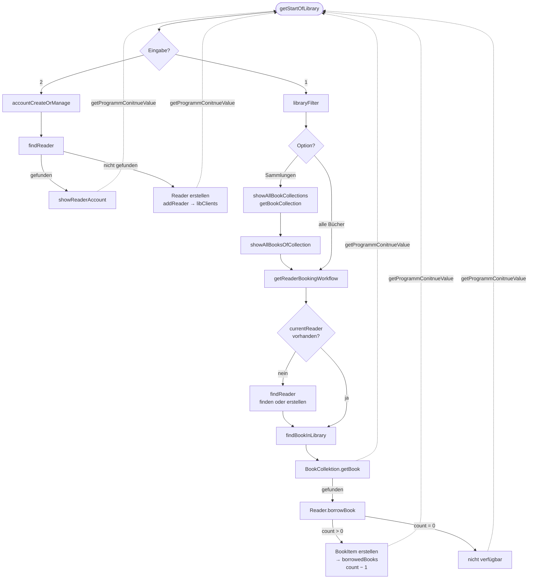

# Dart-Walkthrough (Take-home): Komplexes Konsolenprogramm
## 1. Komplexes Konsolenprogramm Implementierung
### Aufgabe 1.1: Programmarchitektur

```mermaid
classDiagram
    class Library {
        <<data>>
        +libName: String
        +libCollections: Set~BookCollektion~
        +libClients: Set~Reader~
        +Library(String name)
        +getStartOfLibrary: void
        +accountCreateOrManage(Reader? reader) void
        +addReader(Reader client) void
        +findReader(Reader client) Reader?
        +showAllBookCollections() void
        +getBookCollection(int colId) BookCollektion?
        +libraryFilter(Reader? currentReader) void
        +getReaderBookingWorkflow(BookCollektion? currentCollection, Reader? currentReader) void
        +findBookInLibrary(BookCollektion? currentCollection, Reader currentReader) void
    }

    class Reader {
        <<data>>
        +readerId: Int=1
        +name: String
        +address: String
        +borrowedBooks: List~BookItem~
        +Reader(String name, String address)
        +showReaderAccount() void
        +borrowBook(Book currentBook) Book?
    }        

    class BookCollektion {
        <<data>>
        +collId: Int=1
        +genre: String
        +booksCount: Int=0;
        +books: List~Book~
        +BookCollektion(String genre)
        +showAllBooksOfCollection() void
        +getBook(dynamic bookParam) Book?
    }    

    class Book {
        <<data>>
        +bookId: Int=1
        +author: String
        +title: String
        +genre: String
        +description: String
        +isbn: String
        +count: Int=0;
        +Book(String author, String title, String genre, String description, String isbn, Int count);
        +bookItems: List~BookItem~
        +addBookToLibrary(Library libr) void
    }     

    class BookItem {
        <<data>>
        +bookItemIsbn: String
        +bookItemTitle: String
        +author: String
        +readerId: Int
        +bookTime : DateTime
        +returnTime : DateTime      
        +extensions: Int=5
        +BookItem(String bookItemIsbn, String author, String bookItemTitle, Int readerId);
    }  
```

**class Library:**
- Der Konstruktor fordert einen Bibliotheksnamen. So kann der Bestand mehrerer Bibliotheken organisiert und eine mögliche Erweiterbarkeit erzielt werden.
- Eine Bibliothek erhält ein Set aus Bücherkollektionen(libCollections) und ein Set aus Bibliotheksbesuchern(libClients). Fast alle Klassenmethoden operieren mit diesen zwei Parametern. "Set" wurde gewählt, um doppelte Einträge zu vermeiden.
- Die Klasse mit der Methode „getStartOfLibrary” stellt den Ausgangspunkt für das gesamte Programm dar. Hier kann man sich entweder mit dem Bestand der Bibliothek vertraut machen oder das eigene Konto verwalten.
- Wenn man sich für die Kontoverwaltung entscheidet und "2" in der Konsole einträgt, wird die Methode „accountCreateOrManage” aufgerufen. Hier wird mit den Daten von „libClients” operiert. In der Methode „findReader” wird zunächst ein Kunde mit dem angegebenen Namen gesucht. Wenn kein Kunde gefunden wurde, wird dem Benutzer vorgeschlagen, ein eigenes Konto zu erstellen. Ein Objekt der Klasse „Reader” wird mit den Argumenten „name” und „address” erstellt und in den Set „libClients” eingetragen. Bei ungültigen Daten wird der Benutzer aufgefordert, das Verfahren zu wiederholen oder das Programm zu beenden.
- Wenn man sich mit dem Bibliotheksbestand vertraut machen möchte und „1” in die Konsole einträgt, wird die Methode „libraryFilter” aufgerufen. Hier wird mit den Daten von „libCollections” operiert. In dieser Methode gibt es zwei Optionen: Man kann sich entweder erst die bestehenden Buchsammlungen anschauen und anschließend die Bücher des ausgewählten Genres oder alle Bücher gelistet bekommen. Die beiden Verfahren beziehen sich letztlich auf die gleiche Methode „getReaderBookingWorkflow”, mit einem Unterschied: Im Fall von „libCollections” wird das Argument „foundCollection” für die bestimmte Buchsammlung geliefert. Falls diese nicht vorhanden ist, werden alle Bücher in der Methode berücksichtigt. Das Argument „currentReader” ist optional. Es spielt bei den weiteren Funktionsaufrufen eine Rolle.
- Die Methode „getReaderBookingWorkflow“ der Klasse „Library“ bietet die Möglichkeit, das gewünschte Buch auszuleihen. Falls der optionale Parameter „currentReader” nicht übergeben wurde, soll das Konto des Benutzers mit der Methode „findReader” entweder gefunden oder erstellt werden. Erst nachdem der Benutzer bestimmt wurde, kann in der Methode „findBookInLibrary” das Buch mit dem Aufrufen der Methode „getBook” der Klasse „BookCollection” gefunden werden. Falls das Buch gefunden wurde, kann der Benutzer es mit der Methode „borrowBook” der Klasse „Reader” ausleihen.

**class Reader:**
- Wie es bereits in der Klasse "Library" erwähnt wurde, erhält ein Objekt der Klasse "Reader" zwei Parameter: "name" und "address". Die Liste "borrowedBooks" enthält eine Information über die vom Benutzer ausgeliehenen Buchexemplaren. Die Klasse ist dafür vorgesehen, um das Konto vom Benutzer zu verwalten.
- Mit der Methode „borrowBook“ wird geprüft, ob ein Exemplar des gewünschten Buchs vorhanden ist, da bei jedem Ausleihen der Wert des Parameters „count“ der Klasse „Book“ um eins reduziert wird. Wenn das Buch ausgeliehen werden kann, wird ein Objekt der Klasse „BookItem” erstellt und der Liste „borrowedBooks” hinzugefügt.
- Über die Methode „showReaderAccount“ kann der Benutzer Informationen zu seinen ausgeliehenen Büchern abrufen. Hierzu wird einfach die Liste „borrowedBooks” ausgegeben.

**class BookCollektion:**
- Genauso wie die Objekte der Klasse „Reader” sind die Objekte der Klasse „BookCollection” ein Bestandteil der Klasse „Library”. Als Parameter wird „Genre” übergeben, da es das Hauptkriterium für die Klassifizierung der Büchersammlungen ist. „BookCollection” enthält eine Liste der Objekten der Klasse "Book".
- Über die Methode "showAllBooksOfCollection" werden alle Buchbestände der Buchsammlung gelistet, sofern die Länge der Liste "books" größer als 0 ist. Die Funktion wird in der Methode "libraryFilter" der Klasse "Library" aufgerufen.
- Über die Methode „getBook“ kann ein Buch anhand verschiedener Parameter wie „bookId“, „author“, „title“ oder „isbn“ mit unterschiedlichen Typen gesucht werden. Die Begriffe müssen den Parametern aus Gründen der Benutzerfreundlichkeit aber nicht identisch, sondern ähnlich sein. Idealerweise sollte hier eine richtige Validierung eingebaut werden und als Rückgabewert nicht ein, sondern mehrere Bücher ausgegeben werden. Dies wurde absichtlich ausgelassen, um das Programm zu vereinfachen. Die Methode wird in der Methode „findBookInLibrary” der Klasse „Library” aufgerufen und spielt eine Schlüsselrolle im gesamten Programm.

**class Book:**
- Ein Objekt der Klasse „Book” erfordert in der Regel die meisten Parameter für seine Erstellung, da es detaillierte Informationen enthalten muss: „author”, „title”, „genre”, „description” und „isbn”. Das Parameter „count” gibt die Anzahl der Exemplare eines Buches an und kann sich entsprechend verändern. „count” ist auch nötig, um festzustellen, wie viele Exemplare noch nicht ausgeliehen sind.
- Die Klasse verfügt über eine Methode namens „addBookToLibrary“, die nur einmal in der Main-Funktion aufgerufen wird. Dabei werden die Objekte in das Set „books“ nach Genre kategorisiert und als Bestandteile der Büchersammlungen einer Bibliothek zugeordnet.

**class BookItem:**
- Es ist die einzige Klasse im Programm ohne Methoden. Sie dient ausschließlich dazu, die ausgeliehenen Bücher zu kontrollieren. Gleicherweise wie bei einem Objekt der Klasse "Book" werden die Parameter für Author("author"), Buchtitel("bookItemTitle") und eine Isbn-Nummer("bookItemIsbn") ber der Erstellung benötigt.
- In der Klasse werden „DateTime“-Objekte als Parameter verwendet, um das Ausleih- und das Rückgabedatum zu fixieren. Der Parameter „extentions“ deutet darauf hin, dass ein Exemplar höchstens viermal verlängert werden darf. Bei jeder Verlängerung wird der Wert um eins reduziert.
- Die Klasse "BookItem" wird nur von der Klasse "Reader" angesprochen und zwar in der Methode "borrowBook", wo die Objekte von "BookItem" erstellt un in der Liste "borrowedBooks" gespeichert werden, und in der Methode "showReaderAccount", wo die Objekte von "BookItem" aus der Liste "borrowedBooks" ausgelesen werden.

Außerdem gibt es die Funktion „getProgrammConitnueValue”, die keiner Klasse zugeordnet ist. Sie wird an verschiedenen Stellen eingesetzt, an denen eine Entscheidung des Benutzers erforderlich ist, um den weiteren Ablauf des Programms zu bestimmen. Bei einer ungültigen Eingabe wird die Funktion rekursiv aufgerufen.

**Programmablauf:**

Die Unterteilung des Quellcodes in Klassen macht nicht nur den Programmablauf übersichtlicher, sondern erleichtert auch die Wartung und Weiterentwicklung des Programms. So muss nur an einer Stelle in den Klassenmethoden oder in einem Parameter eine Korrektur vorgenommen werden. Die Funktionen können an mehreren Stellen wiederverwendet werden, wodurch eine Dublizierung des Quellcodes vermieden wird (Zum Beispiel die Funktion „getProgrammConitnueValue”).
Die Klassen basieren auf der Analyse eines echten Bibliothekssystems. In einer Bibliothek werden die Bücher nach Themen gruppiert. Jedes Buch kann für eine bestimmte Zeit ausgeliehen werden. Jeder Benutzer hat ein Konto, über das Such- und Leihvorgänge durchgeführt werden.

### Aufgabe 1.2: Problemlösung
**Das Problem:** Es war eine Herausforderung, verschiedene Optionen (Kontoverwaltung, Buchsuchen) in einem Sitz auszuprobieren, bis der Benutzer selber entscheidet das Programm zu beenden. 
Erstens wäre dies benutzerfreundlicher. Zweitens sollen die Informationen beim Wechseln zwischen Büchersammlungen und Kontoverwaltung erhalten bleiben, ohne dass eine zusätzliche Speicherung der Daten erforderlich ist.
**Die Lösung:** Mithilfe der Methode „getProgrammConitnueValue” kann der Benutzer den weiteren Ablauf des Workflows bestimmen, indem er die Frage beantwortet, ob das Programm beispielsweise mit der Ausleihe von Büchern fortgesetzt oder beendet werden soll. 
Die Methode "getReaderBookingWorkflow" ermöglicht den Wechsel zwischen der Darstellung der Büchersammlungen in der Methode „libraryFilter“ und der Kontoverwaltung. Da wird ein Benutzer bestimmt und der Methode "findBookInLibrary" als Parameter übergeben. Über die Methode "findBookInLibrary" wird das ausgewählte Buch der entsprechenden Person zugeordnet.

**Das Problem:** Der Benutzer kann erst ein Konto erstellen und danach sich mit dem Bibliothekbestand vertraut machen und umgekehrt. Es sollte vermieden werden, dass ein Benutzer mehrmals bei einem Sitz identifiziert werden soll.
**Die Lösung:** Da solche Methoden wie "libraryFilter" und "accountCreateOrManage" auf verschiedenen Wegen angesprochen werden, kann das Parameter "Reader? currentReader" einen Nullwert haben. Falls kein "currentReader" übergeben wurde, soll der Benutzer gesucht bzw. erstellt werden.

**Algorithmus**
Die Methode "getReaderBookingWorkflow" der Klasse "Library" ermöglicht eine Verbindung zwischen einer Büchersammlung und einem Benutzerkonto und dient als Kanal für den Informationsaustausch.
1. Sie enthält zwei Parameter mit dem möglichen Nullwert: "BookCollektion? currentCollection" und "Reader? currentReader" und wird in der Methode "libraryFilter" der Klasse "Library" ausgeführt, sowohl bei der Auswahl des Büchersammlungsfilters als auch bei der Auswahl des Bücherlistenfilters. Der einzige Unterschied besteht darin, dass im ersten Fall "currentCollection" als Argument übergeben wird, wodurch sich die Büchersuche vereinfacht. Andernfalls wird ein Nullwert übertragen, sodass eine Iteration durch alle Büchersammlungen erforderlich ist.
2. In der Methode "getReaderBookingWorkflow" wird es gefragt, ob man ein Buch ausleihen möchte. Wenn "libraryFilter" über die Methode "getStartOfLibrary" der Klasse "Library" aufgerufen wird, ist der Benutzer zunächst unbekannt.
In der Methode "getReaderBookingWorkflow" wird ein Benutzer bestimmt. Bei einem Nullwert von "currentReader" wird der Benutzer nach seinem Namen gefragt und sein Konto wird gefunden bzw. erstellt.
3. Die Methode "getReaderBookingWorkflow" gibt den Parameter "client" und den Parameter "currentCollection", der immer noch den Nullwert haben kann, an die Methode "findBookInLibrary" weiter.
4. In der Methode "findBookInLibrary" wird das Buch gefunden und dem Benutzer über die Methode "borrowBook" ausgeliehen. Anschließend wird der Benutzer gefragt, ob er weitere Aktionen durchführen möchte. Bei der Bestätigung kehrt man zum Ausgangspunkt des gesamten Programms, der Methode "getStartOfLibrary", zurück. So läuft das Programm, wie gewollt, bis der Benutzer es selbst beendet.
5. Wird die Methode "libraryFilter" über "accountCreateOrManage" aufgerufen, wird der Benutzer als Parameter weitergeleitet. Dadurch entfällt die Notwendigkeit, einen Benutzer in "getStartOfLibrary" zu identifizieren.

**Die alternative Lösung**
Es wäre möglich, die Daten des aktuellen Benutzers global zu speichern und sie ähnlich wie das Objekt „student” im Quellcode zu verwenden. Dann kann im Quellcode bei Bedarf abgefragt werden, ob der aktuelle Benutzer bereits definiert wurde. Dafür muss allerdings eine zusätzliche Variable gepflegt werden.
Eine andere Lösung besteht darin, eine Session von der Standardbibliothek "dart:io" zu verwenden.
Da es sich nicht um ein vollständiges Projekt, sondern um eine kleine Aufgabe für das Klassenverständnis handelt, wurde eine Lösung mit dem geringsten Aufwand ohne wiederholte Abfragen gewählt: Ein aktueller Benutzer wird über den Parameter übergeben. Außerdem hat sich bei der Verwendung der Variable mit möglichen Nullwert(?) eine Effizienz gezeigt.
Um einen ununterbrochenen Workflow zu erzielen, könnte man nach jeder Aktion zum Startmenü zurückkehren. Mir war es wichtig, zu zeigen, wie elegant sich verschiedene logische Wege mittels Klassen umsetzen lassen.

### Aufgabe 1.3: User Experience
Ohne GUI ist es schwierig, einen benutzerfreundlichen Ablauf zu gewährleisten. Die Trennung zwischen den logischen Abschnitten wurde mittels Zeilenabständen und Trennlinien (print("________________________________________________");) wie in der Methode "showAllBooksOfCollection" erreicht.

## 2. Dart Sprachfeatures Verständnis
### Aufgabe 2.1: Objektorientierung
- Das Programm wurde ohne Vererbung oder Abstraktion umgesetzt, obwohl sie in dem Fall vorteilig sein könnten.

Die Klasse "BookItem" wiederholt die Parameter der Klasse "Book", die den Author("author"), den Titel("bookItemTitle") und die ISBN-Nummer("bookItemIsbn") darstellen. Um unnütze Einträge und Tippfehler zu vermeiden, kann man für die beiden Klassen eine Elternklasse erstellen.

Eine Bibliothek, die in der Klasse "Library" dargestellt wird, kann nicht nur für Büchersammlungen, sondern auch für viele weitere Kategorien wie Audio- und Videoaufnahmen sowie Computerspiele infrage kommen. Gemeinsam sind die Klassifizierung nach Genres und eine Benutzergruppe. Zu diesem Zweck wäre die Verwendung einer abstrakten Klasse sinnvoll.

- Private Felder mit Unterstrich sichern empfindliche Informationen gegen Manipulation von außen. Sie werden in Gettern und Setzern verwendet. In dem Projekt wären Getter und Setter im Hinblick auf die Kontoverwaltung sinnvoll, um die persönlichen Daten der Benutzer zu schützen.
Zusätzlich kann man in Setter eine Validierung der Daten einbauen. Bei der Kontoerstellung wird nach der Adresse des Benutzers gefragt, ohne deren Gültigkeit zu prüfen. Hier wäre die Ansetzung vom Setter vorteilig.

### Aufgabe 2.2: Collections und Datenstrukturen
- Set<Book> books (globale Variable) - Die Bücher in der Bibliothek müssen eindeutig identifiziert werden. Duplikate sind nicht zulässig. Deswegen passt "Set" als Typ in diesem Fall.
List<BookItem> bookItems (die Klasse Book) - Hier geht es um mehrere Exemplare eines Buches. Da die Daten identisch sein müssen passt der Typ "List" gut geeignet.
In diesem Projekt wird der Typ "Map" nicht verwendet, da eine Klasse die Spezifikation von "Map" mit Schlüssel-Wert-Paaren gut widerspiegelt.

- In "List" wird bei der Suche eine Iteration durchgeführt. Deshalb kann eine Suchmethode bei großen Mengen von Elementen langsamer laufen als bei "Set" und "Map", die auf der Hashing-Technik basieren. Bei kleinen Mengen von Elementen ist die Iteration von "List" hingegen schneller. 
Wenn die Reihenfolge der Elemente eine Rolle spielt, sollte "List" benutzt werden, da die Reihenfolge der Elemente bei anderen Typen nicht garantiert ist. Mit "contains" wird eine Existenzprüfung durchgeführt, die für alle drei Typen anwendbar ist.

- In der Methode "libraryFilter" der Klasse "Library" werden alle Büchersammlungen in einer For-Schleife iteriert: 

for(BookCollektion collektion in libCollections){
    collektion.showAllBooksOfCollection();
}

Die For-Schleife ist die am häufigsten verwendete Schleife im Quellcode. Sie ist die effizienteste Methode, um alle Elemente aufzulisten.
In der Methode "addBookToLibrary" der Klasse "Library" soll  eine Buchsammlung entweder nach der Genre gefunden, oder eine neue erstellt werden, falls keine gefunden wurde. Da es um ein bestimmtes Element geht, wird die Abfrage "firstWhere - orElse" verwendet.

BookCollektion collektion = libr.libCollections.firstWhere(
    (item) => item.genre == genre,
    orElse: (){
        wasCreated = true;
        BookCollektion newCollection = BookCollektion(genre);
        newCollection.collId = libr.libCollections.length + 1;
        return newCollection;
    }
);

"map" ist sinnvoll zu benutzen, wenn eine Transformation, z.B. mit "join", durchgefürht werden soll.
"fold" passt für die Fälle, in denen ein vorheriges Element mit dem nachfolgenden interagieren muss.
Da diese Aufgaben im Programm nicht berücksichtigt werden und eine For-Schleife die schnellste Iterationsmethode ist, lasse ich den Quellcode unverändert.

### Aufgabe 2.3: Asynchrone Programmierung
- "Future" wird für die Aufgaben verwendet, bei denen das Ergebnis einer Operation abgewartet werden muss, um anschließend weitere Aktionen auszuführen. "Future" ist eine Art Platzhalter, der anschließend mit einem Wert gefüllt wird.
"Stream" kommt zur Anwendung, wenn keine einmaligen, sondern sequentielle Ergebnisse zu erwarten sind. Sobald ein Ergebnis vorliegt, wird automatisch eine Operation durchgeführt.
- Im Quellcode wird keine asynchrone Programmierung verwendet. In der Methode "findBookInLibrary" der Klasse "Library", in der ein bestimmtes Buch in der Bibliothek gesucht wird, wäre sie jedoch sinnvoll. Erst nachdem es gefunden wurde, kann es ausgeliehen werden. Diese Methode ist besonders sinnvoll, wenn eine Bibliothek über einen großen Bestand verfügt.

## 3. Code-Qualität und Best Practices
### Aufgabe 3.1: Code-Qualität
- Variablen und Funktionen verwenden camelCase, bei dem der erste Buchstabe klein und die Wortgrenzen mit großen Buchstaben geschrieben werden. Konstanten können sowohl mit camelCase als auch gemäß einer Tradition mit UPPER_CASE großgeschrieben werden, wobei an den Wortgrenzen ein Unterstrich steht.
- Klassennamen und Enums verwenden PascalCase. Dabei beginnen sowohl der erste Buchstabe als auch die Wortgrenzen mit einem großen Buchstaben.
- Dateinamen werden nach dem Prinzip "snake_case" kleingeschrieben und mit Unterstrichen an den Wortgrenzen gebildet.

### Aufgabe 3.2: Testing und Debugging

### Aufgabe 3.3: Performance und Skalierbarkeit